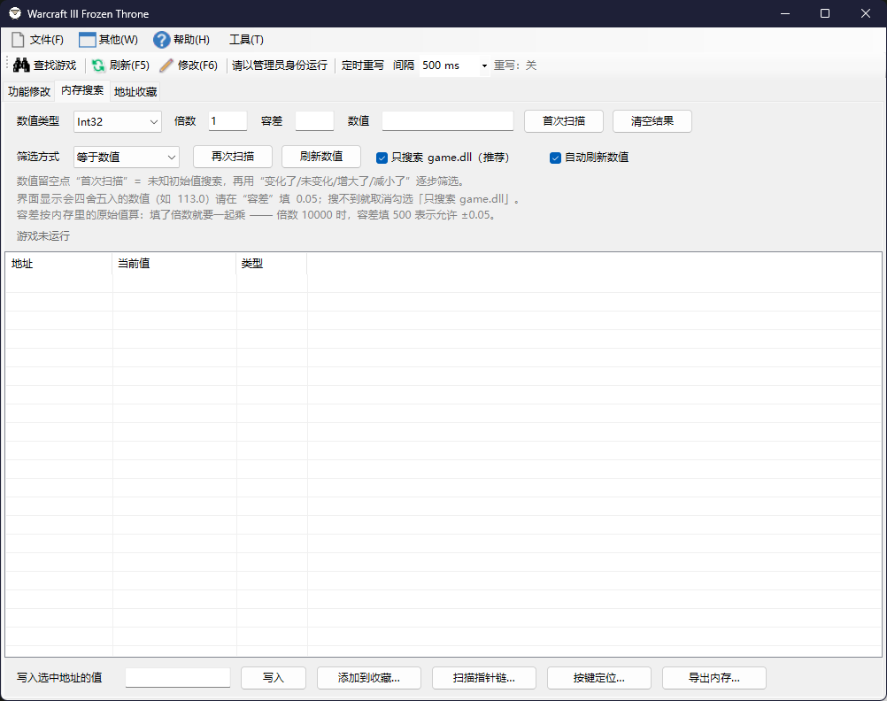

<div align="center">


# War3Trainer


[](https://github.com/a794443642/War3Trainer/actions/workflows/build.yml)



</div>

## 简介

**War3Trainer** 是《魔兽争霸 III：冰封王座》的内存修改器。它直接读写游戏进程的内存，
实时修改英雄属性、金钱木材、单位数据，并在经典版本的基础上加入了**内存搜索**、
**指针链扫描**、**按键定位**、**地址收藏**和**定时重写**。

界面分三个页签，顶部工具栏在任何页签下都能操作：

| 区域 | 内容 |
| --- | --- |
| 工具栏 | `查找游戏` · `刷新(F5)` · `修改(F6)` · `定时重写` 开关 · `间隔` · 游戏状态提示 |
| 菜单 **文件** | 调试用 `ReadFromGameMemory`、`退出` |
| 菜单 **其他** | 窗口总在最前、加大修改长度、数值倍数修改（1x–5x） |
| 菜单 **工具** | 内存搜索、地址收藏、导出内存、打开收藏文件位置 |
| 菜单 **帮助** | 关于 |

> 本工具**仅用于单机 / 自建局域网地图**，不适用于任何对战平台，详见[注意事项](#注意事项)。

---

## 功能修改

左侧是功能树（游戏资源、选中单位、物品列表、英雄属性……），右侧表格列出该分类下的地址：

| 名称 | 数值 | 修改 | 定时重写 |
| --- | --- | --- | --- |
| 攻击① - 基础伤害 | 66 | *(双击填写)* | *(重写中时显示)* |

* 双击「修改」列（或选中行直接输入）填新值，按 <kbd>F6</kbd> 或点工具栏 `修改` 写入；
  `刷新(F5)` 重新读取当前数值。
* 未写入的修改在切换分类时会自动提交，不会丢。
* `其他 → 数值倍数修改` 可把当前值按 2x–5x 预填到编辑框，省得手算。
* `其他 → 加大修改长度` 把输入框上限从 7 位放宽到 35 位（大数值 / Char4 用）。

---

## 内存搜索

不依赖内置地址表，直接从内存里找值：

* **数值类型**：`Int32`、`Float`、`Char4`、`UInt16`。
* **首次扫描**：填「数值」后按类型全量搜索；数值留空 = **未知初始值**搜索。
* **再次扫描**：用「等于数值 / 变化了 / 未变化 / 增大了 / 减小了」逐步筛小结果集。
* **倍数 / 容差**：界面显示值可以带倍数（如生命值 ×10000）；容差用于浮点误差，
  按内存原始值计算，填了倍数要一起乘。
* **只搜索 game.dll（推荐）**：默认只扫 Game.dll 的静态区，速度快、误报少；
  搜不到时取消勾选再全内存搜。
* **自动刷新数值**：每秒刷新结果列表里的当前值。

结果列表列为 `地址 / 当前值 / 类型`，支持多选、<kbd>Ctrl</kbd>+<kbd>C</kbd> 复制、
右键「复制地址 / 复制地址+数值 / 全选」。底部一行是常用动作：

`写入选中地址的值` → **写入** · **添加到收藏…** · **扫描指针链…** · **按键定位…** · **导出内存…**

双击结果行也可以直接加入收藏。

---

## 地址收藏

把地址存下来，重启游戏后继续可用（存的是「模块 + 偏移 + 指针链」，不是绝对地址）：

| 名称 | 地址表达式 | 当前地址 | 当前值 | 类型 | 定时重写 | 备注 |
| --- | --- | --- | --- | --- | --- | --- |
| 金币 | `game.dll+AD5C18` | `0x6FAD5C18` | `900000` | Int32 | ☑ | |

* **新增 / 编辑 / 删除 / 保存 / 重新载入**：常规增删改查。
* **写入(&W)**：把「要写入的值」写进选中条目。
* **指针链(&P)**：给选中条目补一条多级指针链（重启后仍可解析）。
* **按键定位(&A)**：对「按键定位」条目重新定位。这类条目存的是按键触发的堆地址，
  重启游戏后点一次即可恢复。
* **清理失效(&X)**：进图后一次性删除解析不出数值的条目（会跳过并保护按键定位条目）。

收藏文件：`%APPDATA%\War3Trainer\addresses.xml`（不可写时退回程序目录）。
`工具 → 打开收藏文件位置` 可以直接定位到它。

---

## 定时重写

地图脚本（触发器）每帧都在重算金币、人口、英雄属性，**只写一次**的修改往往几秒后就被改回去。
**定时重写**按固定间隔把数值不断写回内存，把脚本的重算压住。

* 工具栏上的 `定时重写` 开关（默认开启）和 `间隔` 框（默认 `500 ms`）。
* 间隔可手填：`100 ms`、`0.5s`、`1 秒` 都能识别，范围 **50 ms ~ 60 秒**；
  下拉里给了 100 ms / 250 ms / 500 ms / 1 秒 / 2 秒 / 5 秒 的预设。
* **功能修改 页**：开关打开时，按 `修改(F6)` 写入过的行会被登记，列表的
  `定时重写` 列显示当前被压住的值；右键行可「加入 / 移出 / 清除全部定时重写」。
* **地址收藏 页**：条目勾上「定时重写」后按同一间隔回写。
* 开关与间隔保存在 `rewrite.txt`（与 `addresses.xml` 同目录），下次启动继续生效。
* 关掉总开关 = 完全停止回写，原来的「只写一次」行为不变。

> 定时重写只影响本机游戏进程的内存，不向网络发送任何数据。

---

## 系统要求

* Windows（`.NET Framework 4.8` 运行环境）。
* **需要管理员权限**：读写其他进程内存要靠 `SeDebugPrivilege`，程序清单已声明
  `requireAdministrator`，启动时会弹 UAC；拒绝提权时工具栏会提示「请以管理员身份运行」。
* 32 位《魔兽争霸 III：冰封王座》（1.20e ~ 1.28f），兼容网易对战平台的 `dzwar3` 进程。
* 单机 / 局域网自建地图；不适用于战网与对战平台。

## 版本支持

| 版本 | 内部版本号 |
| --- | --- |
| 1.20e | 1.20.4.6074 |
| 1.21a / 1.21b | 1.21.0.6263 / 1.21.1.6300 |
| 1.22 | 1.22.0.6328 |
| 1.23 | 1.23.0.6352 |
| 1.24a – 1.24e | 1.24.0.6372 … 1.24.4.6387 |
| 1.25b | 1.25.1.6397 |
| 1.26 | 1.26.0.6401 |
| 1.27a | 1.27.0.52240 |
| 1.28 / 1.28f | 1.28.0.7205 / 1.28.5.7680 |

## 命令行参数

```
War3Trainer.exe [--tab=0|1|2] [--book=<收藏文件路径>]
```

* `--tab`：启动时选中页签，`0` 功能修改（默认）、`1` 内存搜索、`2` 地址收藏。
* `--book`：指定收藏文件位置，用于便携模式（把 `addresses.xml` 放在程序旁边）。

## 数据文件

| 文件 | 位置 | 说明 |
| --- | --- | --- |
| `addresses.xml` | `%APPDATA%\War3Trainer\` | 地址收藏（自动留 `.bak` 备份） |
| `rewrite.txt` | 与收藏文件同目录 | 定时重写的开关与间隔 |
| `crash.log` | `%APPDATA%\War3Trainer\` | 未处理异常日志 |

## 注意事项

1. **仅限单机**：只在自定义游戏 / 战役里使用。
2. **不能用于对战**：不适用于官方战网或任何对战平台；程序不向网络发送欺骗性数据。
3. **局域网联机**：想让朋友一起联机打 RPG 地图，**每台机器都要做完全相同的修改**，
   否则数据不同步会立刻掉线。

## 构建与发布

### 本地构建

用 Visual Studio 2019/2022 打开 `War3Trainer.sln`（目标框架 `.NET Framework 4.8`），
配置选 `Release` 构建即可：

```
War3Trainer/bin/Release/War3Trainer.exe
```

编译需要「.NET Framework 4.8 目标包 / 开发工具」，`bin`、`obj` 已在 `.gitignore` 中排除。

### 自动构建（GitHub Actions）

`.github/workflows/build.yml` 在三种情况下运行：

| 触发 | 动作 |
| --- | --- |
| push 到 `main` / 提交 PR | 只构建并上传 Artifacts，用来发现编译错误 |
| push `v*` 标签 | 构建 + 打包 + **创建 Release** |
| Actions 页手动 `Run workflow` | 填了版本号就发布，留空只构建 |

发布流程：

```bash
git tag v16.0.0
git push origin v16.0.0
```

几秒后 Actions 会生成 `War3Trainer-v16.0.0.zip`（内含
`War3Trainer.exe`、`.exe.config`、`README.md`、`手册.txt`、`What's new.txt`、`LICENSE`），
并在 <https://github.com/a794443642/War3Trainer/releases> 创建对应 Release。

也可以在 GitHub 网页 **Actions → Build & Release → Run workflow**，
在 `version` 里填 `v16.0.0` 手动发布（会自动在当前 `main` 上打标签）。


## 项目结构

```
War3Trainer/
├─ War3Trainer.sln
├─ Screenshot.png               # 界面截图
├─ LICENSE                      # MIT
├─ What's new.txt               # 更新日志
├─ 手册.txt                     # 使用与开发手册（含逆向笔记）
└─ War3Trainer/                 # 源码
   ├─ Program.cs                # 入口 / 命令行 / 崩溃日志
   ├─ MainForm.cs               # 主窗体：功能树、属性表、写入
   ├─ MainForm.Scanner.cs       # 三个页签、内存搜索页、收藏页、定时重写 UI
   ├─ MainForm.Designer.cs      # 设计器代码
   ├─ GameContext.cs            # 查找 war3 / dzwar3 进程、版本识别
   ├─ GameTrainer.cs            # 内置地址表（属性 / 资源 / 单位 / 物品）
   ├─ ProcessMem.cs             # 进程内存读写（ReadProcessMemory 封装）
   ├─ War3Common.cs             # 游戏内存结构解析
   ├─ MemoryScanner.cs          # 数值扫描（首次 / 再次 / 未知值）
   ├─ PointerScanner.cs         # 指针扫描
   ├─ PointerScannerChains.cs   # 多级指针链
   ├─ KeyLocator.cs             # 按键定位（热键 → 堆地址）
   ├─ AddressBook.cs            # 地址收藏（模块+偏移+指针链，XML）
   ├─ RewriteEngine.cs          # 定时重写引擎 / 间隔解析 / 配置
   ├─ PointerScanDialog.cs      # 指针链扫描对话框
   ├─ KeyLocatorDialog.cs       # 按键定位对话框
   ├─ MemoryDumpDialog.cs       # 内存导出对话框
   ├─ SavedAddressDialog.cs     # 收藏条目编辑对话框
   ├─ ListViewEx.cs             # 带滚动事件的 ListView
   ├─ Settings.cs / War3Common.cs / *Exception.cs
   └─ Properties/               # 程序集信息、资源、设置
```

## 更新记录

见 [What's new.txt](What's%20new.txt)。

## 鸣谢

本项目的经典功能来自 [Still4/War3Trainer](https://github.com/Still4/War3Trainer)
（作者 tctianchi，MIT 许可），感谢原作者奠定的基础。
本仓库在其之上做了二次开发：内存搜索页、指针链、按键定位、地址收藏与定时重写。

## 许可

[MIT License](LICENSE)。
